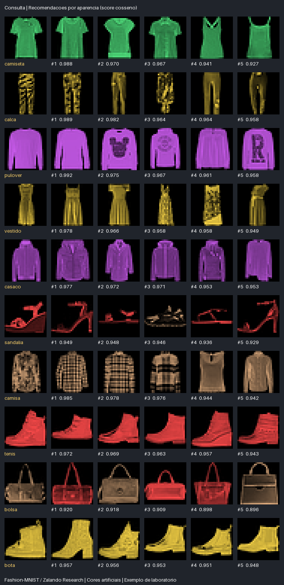

# Sistema de recomendação de produtos por imagens

Projeto DIO que treina uma rede de Deep Learning em várias classes de produtos e recomenda itens pela **aparência visual**. O ranking compara descritores extraídos das imagens, sem usar preço, marca, loja, descrição textual ou filtro pela categoria prevista.

**Autor:** Giordani Martins Silva. Implementação e documentação preparadas com auxílio de IA.

[](https://colab.research.google.com/github/1giordani/trilha-python-dio/blob/main/projetos/recomendacao-visual-produtos/recomendacao_por_imagens.ipynb)

## Resultado executado



Cada linha mostra a primeira consulta de uma das dez classes e seus cinco vizinhos do catálogo. As consultas foram escolhidas por uma regra fixa, sem selecionar somente exemplos com bons resultados. Os números são similaridades cosseno, não probabilidades de compra ou de equivalência entre produtos.

O exemplo usa **Fashion-MNIST / Zalando Research**, originalmente em cinza. As cores são **artificiais**, aplicadas independentemente da classe para demonstrar um componente cromático. Não representam cores originais de produtos da Zalando. As classes incluem camiseta, calça, pulôver, vestido, casaco, sandália, camisa, tênis, bolsa e bota.

## Como funciona

1. A CNN aprende a classificar dez categorias usando somente as imagens.
2. A saída intermediária de 64 dimensões é reutilizada como embedding visual.
3. Um histograma RGB de 24 dimensões, com oito bins por canal, acrescenta informação explícita de cor; não é uma camada aprendida.
4. Embedding e histograma são normalizados e concatenados com pesos predefinidos: 75% e 25%.
5. O catálogo é indexado com esse descritor de 88 dimensões.
6. A imagem de consulta passa pelo mesmo processamento; a similaridade cosseno ordena os itens e retorna os cinco primeiros.

Com e e h normalizados, o descritor é `[sqrt(0.75) × e, sqrt(0.25) × h]`. Seu cosseno equivale à combinação ponderada dos cossenos dos dois componentes. Os pesos foram fixados antes da avaliação das consultas. Não existe uma regra “se classe X, recomende X”: as categorias são usadas no treinamento e na avaliação aproximada, mas **não entram na função de ranking**.

A CNN usa Rescaling → Conv2D → MaxPooling → Conv2D → MaxPooling → Flatten → Dense(64, embedding) → Dense(10, softmax). A rede foi treinada do zero por cinco épocas no piloto. O modelo classificador e o encoder são exportados separadamente; a busca precisa apenas do encoder e do índice do catálogo.

## Base, separação e avaliação

| Grupo | Quantidade | Origem e finalidade |
| --- | --- | --- |
| Treino | 8.000 | Parte do treino oficial; 800 por categoria |
| Validação | 1.000 | Outra parte do treino oficial; seleção da época |
| Catálogo | 1.000 | Parte do teste oficial; 100 por categoria |
| Consultas de avaliação | 500 | Outra parte do teste oficial; 50 por categoria |

A seleção usa semente 42. Hashes dos pixels originais são conferidos **antes da colorização**, evitando imagens exatamente iguais em grupos diferentes, mesmo que recebessem cores distintas. O [manifesto](evidencias/manifesto.json) registra origem, índice, hash e cor artificial atribuída. A checagem não elimina imagens quase iguais nem garante generalização para fotografias externas.

As imagens têm 28×28 pixels. São ampliadas somente para visualização; o sistema não recupera detalhes ou textura fina inexistentes na base. A colorização mantém a estrutura de intensidades da imagem e atribui uma de seis cores, sem depender do rótulo de categoria.

## Métricas reais do piloto

| Medida | Resultado |
| --- | --- |
| Acurácia do classificador nas consultas | 80,40%: 402/500 |
| Precision@5 por categoria | 64,92%: 1.623/2.500 recomendações |
| Hit rate@5 por categoria | 92,60%: 463/500 consultas |
| Precision@5 do ranking aleatório | 10,24% |
| Mesma cor artificial entre os cinco primeiros | 94,00%: 2.350/2.500 |

**Precision@5** considera relevante um item da mesma categoria da consulta. **Hit rate@5** verifica se existe pelo menos um item da mesma categoria nos cinco resultados. São proxies: produtos de categorias diferentes podem ser visualmente parecidos, e produtos da mesma categoria podem ter estilos muito diferentes. A concordância de cor avalia apenas a paleta artificial, não cores reais de um catálogo comercial.

Esses números não medem satisfação de usuários, conversão, recomendação personalizada ou relevância avaliada por pessoas. Veja [métricas completas](evidencias/metricas.json), incluindo desempenho por classe, e [ranking das consultas](evidencias/ranking-consultas.json). Resultados menos fortes, como os da classe camisa, são preservados.

## Executar no Colab

Abra o notebook pelo botão acima e execute na ordem. Ele instala dependências, baixa o código, treina a rede, constrói o índice, avalia as consultas, exibe recomendações e permite enviar uma imagem. A última etapa baixa um ZIP com modelo, índice e evidências.

Use Python 3.11/3.12. Se houver solicitação de reinício após instalar dependências, reinicie antes de importar TensorFlow. O piloto pode executar em CPU. O notebook é entregue sem saídas para reprodução limpa; as evidências publicadas vieram de execução local, não de uma sessão no Colab.

## Executar localmente

```bash
git clone https://github.com/1giordani/trilha-python-dio.git
cd trilha-python-dio/projetos/recomendacao-visual-produtos
python -m venv .venv
# Linux/macOS: source .venv/bin/activate
# Windows PowerShell: .venv\Scripts\Activate.ps1
python -m pip install -r requirements.txt
python train.py --epochs 5
python recommend.py exemplos/consulta.png --output resultados
```

Em vez de treinar novamente, é possível extrair o pacote treinado disponibilizado nesta entrega. Ele contém artefatos/encoder.keras, classificador.keras, catalogo.npz, consultas.npz e metadata.json. Não basta baixar apenas o código para executar inferência sem esses artefatos ou sem treinamento.

A primeira execução de treino baixa a base pelo loader do TensorFlow. O diretório artefatos/ fica fora do git para evitar adicionar pesos e catálogos grandes automaticamente. JSON e imagem de uma consulta já executada estão em [exemplos/resultado/recomendacoes.json](exemplos/resultado/recomendacoes.json) e [exemplos/resultado/recomendacoes.png](exemplos/resultado/recomendacoes.png).

## Interface para o usuário

```bash
python -m pip install -r requirements-ui.txt
python -m streamlit run app.py
```

A interface local permite escolher um produto do catálogo ou enviar PNG/JPEG/WebP, visualizar a consulta e receber até cinco recomendações com escores. Um item idêntico à consulta é excluído quando encontrado no índice. O identificador é exibido apenas para localizar o produto; não influencia sua posição no ranking.

A interface foi exercitada com modelo real pelo AppTest do Streamlit: abertura e mudança do item consultado, sem exceções. Veja [registro](evidencias/interface.json). **Não foi feita hospedagem pública de um site**. O notebook demonstra a consulta sem expor portas nem depender da interface web.

## Catálogo próprio e imagens da internet

O sistema recebe uma imagem salva/enviada e busca **no catálogo indexado**; não faz buscas em lojas ou download automático de produtos da internet.

Coloque imagens próprias ou licenciadas em catalogo-proprio/ e execute:

```bash
python index_catalog.py catalogo-proprio --output artefatos/catalogo-proprio.npz
python recommend.py produto_consultado.jpg --catalog artefatos/catalogo-proprio.npz
```

Na interface, altere o campo “Índice do catálogo” para o novo arquivo. O script remove imagens processadas exatamente iguais e usa o caminho relativo do arquivo apenas como identificador. Não lê marca, preço ou metadados comerciais.

A consulta e o catálogo devem ter pré-processamento consistente. As imagens do laboratório têm fundo preto e produto centralizado. A interface oferece inversão explícita das cores, mas isso também muda as cores do objeto: não é remoção de fundo e não deve ser aplicado indiscriminadamente. Para fotos reais, prefira tratar fundo e escala de maneira adequada e validar novamente a representação. Um catálogo próprio com milhares de fotos de lojas não foi avaliado nesta entrega.

## Testes e evidências

```bash
python -m unittest test_visual -v
python validar_estrutura.py
```

Os dez testes cobrem normalização, vetores vazios, ordem do cosseno, exclusão do próprio item, empates, validação de k, diferenciação de cores, imagem sem conteúdo, pré-processamento e colorização de fundo preto. Os testes não substituem uma avaliação com usuários.

- [Treinamento executado](evidencias/treinamento.log).
- [Histórico](evidencias/historico.json).
- [Métricas](evidencias/metricas.json).
- [Manifesto sem sobreposição exata](evidencias/manifesto.json).
- [Dez testes](evidencias/testes.txt).
- [Interface local testada](evidencias/interface.json).
- [Estrutura e consistência das evidências](evidencias/estrutura.json).

## Limitações e evolução

- A rede aprende categorias, não uma função de preferência humana nem uma perda contrastiva de similaridade.
- Cores são artificiais, textura é limitada pela resolução e o domínio cobre somente moda simples.
- Fotos de bicicletas, relógios, cenários complexos ou múltiplos produtos estão fora do piloto e não foram validadas.
- A busca sempre retorna os vizinhos disponíveis; não há detector de consulta fora de domínio nem garantia de que um score alto significa recomendação adequada.
- Similaridade visual não considera disponibilidade, tamanho, preço, preferências pessoais ou compatibilidade comercial.
- O índice em NumPy usa busca exata; catálogos muito maiores podem exigir indexação aproximada e novos testes de qualidade/latência.

Para evoluir, use um catálogo RGB real com licença apropriada, treino/validação adequados ao domínio, embeddings treinados por similaridade e julgamentos humanos de relevância. Compare representações sem ajustar pelo conjunto final de teste.

## Arquivos e créditos

visual.py contém somente descritores e busca; train.py treina e avalia; recommend.py consulta; index_catalog.py constrói catálogo próprio; app.py fornece a interface; figures.py gera a comparação visual; build_notebook.py gera o roteiro Colab; validar_estrutura.py verifica evidências. A descrição de submissão está em ENTREGA-DIO.md.

- Desafio educacional: Digital Innovation One.
- Base: [Fashion-MNIST, Zalando Research](https://github.com/zalandoresearch/fashion-mnist). A [licença original](LICENSE-FashionMNIST.txt) é preservada; a colorização deste projeto é uma transformação de demonstração.
- Loader: [TensorFlow/Keras](https://www.tensorflow.org/api_docs/python/tf/keras/datasets/fashion_mnist/load_data).
- Referência indicada no enunciado: [Image Similarity Recommendations](https://colab.research.google.com/github/sparsh-ai/rec-tutorials/blob/master/_notebooks/2021-04-27-image-similarity-recommendations.ipynb).

O Colab de referência apresentou login nesta preparação. A implementação segue os requisitos descritos no enunciado e não alega ter executado aquele notebook nem assistido às aulas. O exemplo e suas métricas são um piloto documentado, não um recomendador comercial pronto.
