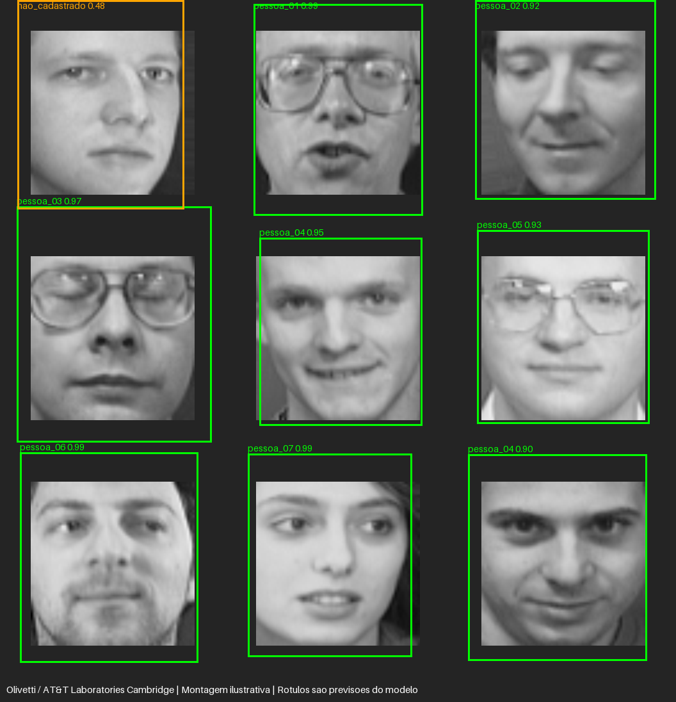

# Sistema de reconhecimento facial com TensorFlow

Projeto DIO com duas redes: uma **MTCNN pré-treinada para detectar faces** e uma **CNN de classificação em TensorFlow/Keras treinada do zero** para reconhecer as identidades cadastradas. Todas as faces detectadas são processadas, com classificação em lote.

**Autor:** Giordani Martins Silva. Código e documentação preparados com auxílio de IA.

[](https://colab.research.google.com/github/1giordani/trilha-python-dio/blob/main/projetos/reconhecimento-facial-tensorflow/reconhecimento_facial.ipynb)

## Exemplo executado



A imagem é uma **montagem ilustrativa**, formada pela primeira foto de validação de cada uma das oito classes conhecidas e uma foto de uma classe não cadastrada usada na calibração. Ela não é uma foto natural de grupo nem um teste independente. As caixas, rótulos e escores são saídas reais do pipeline; não foram substituídos por anotações corretas.

Os identificadores pessoa_00 a pessoa_07 são rótulos numéricos de laboratório. Não são nomes reais nem uma busca pela identidade de qualquer pessoa da internet. O [JSON da montagem](evidencias/multiplas_faces.json) inclui os índices de origem e compara cada previsão com o rótulo esperado, deixando visíveis rejeições e erros.

## Arquitetura

1. Abrir a imagem local e respeitar sua orientação EXIF.
2. Detectar todas as faces pela MTCNN, com confiança mínima 0,9.
3. Limitar as caixas às dimensões da imagem.
4. Alinhar pelos olhos fornecidos pelo detector, usando uma transformação de similaridade. Os olhos ficam nas posições (20,24) e (44,24) da entrada 64×64. Na ausência de landmarks, o código permite recorte por caixa com margem.
5. Converter para cinza e formar um lote com todas as faces.
6. Classificar pelo modelo TensorFlow: Rescaling → Conv2D → MaxPooling → Conv2D → MaxPooling → Flatten → Dense → Dropout → Dense softmax.
7. Aplicar um limiar ao maior escore e desenhar caixas e rótulos. Abaixo do limiar, exibir nao_cadastrado.

O detector reutiliza pesos pré-treinados da biblioteca mtcnn 1.0.0; ele não foi treinado neste projeto. O classificador possui pesos aprendidos neste projeto e oito saídas no piloto. Logo, “do zero” refere-se à implementação e ao treinamento da rede de classificação, respeitando a exigência de um detector já treinado.

## Base e protocolo do piloto

Usamos a base de pesquisa **Olivetti/AT&T Laboratories Cambridge**, acessada por fetch_olivetti_faces do scikit-learn. O acervo contém 400 imagens em cinza de 40 sujeitos, dez por sujeito; a versão do loader tem 64×64 pixels.

O piloto utiliza somente os sujeitos 0–11:

| Grupo | Identidades | Protocolo planejado |
| --- | --- | --- |
| Treino conhecido | 0–7 | 6 fotos por identidade: 48 |
| Validação conhecida | 0–7 | 2 fotos por identidade: 16 |
| Teste conhecido | 0–7 | 2 fotos por identidade: 16 |
| Calibração de desconhecidos | 8–9 | 20 fotos, sem treino do classificador |
| Teste de desconhecidos | 10–11 | 20 fotos, identidades diferentes da calibração |

Os índices são separados antes da detecção, com semente 42. Fotos sem uma detecção acima do limiar são registradas em skipped; não são substituídas silenciosamente por um recorte conhecido. O JSON informa as quantidades realmente usadas. O protocolo de identificação conhecida mantém as mesmas identidades nos três primeiros grupos, com fotos distintas; ele não testa reconhecimento de identidades nunca cadastradas.

As imagens Olivetti já são recortes de faces. Para a detecção de demonstração, são ampliadas e colocadas em uma tela com margem. A montagem usa a mesma escala de fotos. O alinhamento pelos olhos reduz a dependência do tamanho da caixa. Isso não equivale a treinar e avaliar sobre fotos variadas de câmeras reais.

## Resultados e limites

| Medida do piloto final | Resultado |
| --- | --- |
| Faces aproveitadas em treino / validação / teste | 48 / 16 / 16 |
| Épocas executadas / melhor época por val_loss | 38 / 30 |
| Acurácia fechada nos conhecidos | 87.50% (14/16) |
| Conhecidos corretamente aceitos com limiar | 62.50% (10/16) |
| Desconhecidos rejeitados | 94.74% (18/19) |
| Desconhecidos aceitos indevidamente | 5.26% (1/19) |
| Limiar escolhido na calibração | 0.9 |
| Faces detectadas na montagem | 9 de 9 |
| Identidades conhecidas corretamente aceitas na montagem | 7 de 8 |

O teste de desconhecidos tinha 20 imagens planejadas; uma não teve detecção >=0,9. As métricas condicionam-se às faces detectadas. A montagem inclui sete acertos de identidade, uma pessoa cadastrada rejeitada e um falso aceite de não cadastrado. Isso evidencia a limitação do limiar, inclusive em um domínio controlado.


A acurácia fechada responde “qual das oito classes cadastradas é mais provável?”, sem rejeição. A aceitação correta também exige ultrapassar o limiar. A rejeição de não cadastrados usa identidades distintas da calibração. Essas medidas não são intercambiáveis.

O limiar é escolhido somente pela validação conhecida e pela calibração de desconhecidos: maximiza a média entre conhecidos corretamente aceitos e desconhecidos rejeitados; empates favorecem o limiar maior. O teste não seleciona o limiar. Uma probabilidade softmax alta **não garante** que a pessoa esteja cadastrada; falsos aceites são registrados e podem ocorrer.

Este é um desenvolvimento exploratório: inspeções da montagem revelaram diferenças de recorte, motivando padronização e alinhamento. As métricas documentam o piloto final, não um benchmark selado ou validação de produto. O [diagnóstico inicial](evidencias/diagnostico-recorte-inicial.json) preserva o primeiro problema observado. A montagem final usa validação/calibração e todas as classes conhecidas, sem escolher fotos pelo acerto da previsão.

## Executar no Colab

Abra o notebook pelo botão e execute na ordem. Ele instala dependências, baixa o código e a base de pesquisa, treina a CNN, calibra o limiar, avalia os grupos reservados e exibe a montagem. O piloto roda em CPU e não exige GPU. Caso o Colab solicite reinício após a instalação, reinicie antes dos imports.

O notebook é um roteiro pronto para execução, entregue sem outputs. A execução registrada foi **local**, não uma sessão do Colab. Não foram acessados os conteúdos das aulas nem declarada sua conclusão.

## Executar no computador

Use Python 3.11 ou 3.12, preferencialmente em ambiente virtual:

```bash
git clone https://github.com/1giordani/trilha-python-dio.git
cd trilha-python-dio/projetos/reconhecimento-facial-tensorflow
python -m venv .venv
# Linux/macOS: source .venv/bin/activate
# Windows PowerShell: .venv\Scripts\Activate.ps1
python -m pip install -r requirements.txt
python train.py --epochs 40
python infer.py artefatos/cena_demo.png
```

A primeira execução baixa a base Olivetti. As redes de detecção vêm com a biblioteca mtcnn. O treinamento gera artefatos/classificador.keras e artefatos/metadata.json; ambos são necessários para inferência. No Windows, use py no lugar de python se essa for sua instalação.

Para processar outra imagem de laboratório:

```bash
python infer.py minha_imagem.jpg --output resultados
```

O script salva reconhecimento.png e deteccoes.json. Se nenhuma face passar pelo detector, retorna lista vazia e preserva uma cópia visual da imagem. Não ativa webcam nem inicia servidor. A saída nao_cadastrado é uma heurística; não deve ser usada como garantia de identidade desconhecida.

## Cadastrar suas próprias classes

Organize fotos **individuais de participantes autorizados**, por exemplo:

```text
dados-pessoais/
  participante_a/ foto01.jpg, foto02.jpg, ...
  participante_b/ foto01.jpg, foto02.jpg, ...
```

Cada pasta precisa de pelo menos dez fotos válidas, com exatamente uma face detectável por imagem. Prefira diferentes sessões, iluminação e poses. Não basta duplicar a mesma foto: hashes idênticos são rejeitados, e fotos quase iguais ainda podem causar vazamento entre grupos.

```bash
python train_custom.py --data dados-pessoais --epochs 40 --threshold 0.8
python infer.py foto_grupo.jpg --model artefatos-personalizados/classificador.keras --metadata artefatos-personalizados/metadata.json --output resultados-proprios
```

O cadastro personalizado separa arquivos em 60/20/20, mas não reconhece sessões automaticamente. Seu limiar é fornecido pelo usuário e **não é calibrado com desconhecidos**. Esse fluxo é incluído no código; não foi treinado com fotos privadas nesta entrega. A pasta dados-pessoais e os artefatos personalizados estão no .gitignore, e não há envio automático de fotos/nomes para um servidor. As rotinas só fazem downloads para dependências e base de demonstração quando solicitadas.

## Evidências e testes

- [Métricas e índices dos grupos](evidencias/metricas.json).
- [Histórico de treinamento](evidencias/historico.json).
- [Calibração do limiar](evidencias/calibracao.json).
- [Log do treinamento](evidencias/treinamento.log).
- [Demonstração de várias faces](evidencias/multiplas_faces.json).
- [Testes automatizados](evidencias/testes.txt).
- [Validação de estrutura](evidencias/estrutura.json).

```bash
python -m unittest test_faces -v
python validar_estrutura.py
```

Os oito testes cobrem limites de caixas, pré-processamento, identidade geométrica do alinhamento, limiar, probabilidades inválidas, processamento de três faces em lote e imagem sem face. Alguns usam detector/modelo simulados para testar a lógica; a evidência da rede real é a execução Olivetti, não os stubs.

Há poucas imagens por sujeito; classes e condições visuais são restritas. Não há teste de vivacidade, proteção contra fotos apresentadas à câmera, avaliação demográfica, validação externa ou calibração de probabilidades. O exemplo não é um sistema pronto de autenticação ou vigilância. Generalização e taxas de erro devem ser medidas com dados apropriados antes de qualquer uso real.

## Arquivos

- faces.py: detecção, alinhamento e reconhecimento de múltiplas faces.
- train.py: treino e avaliação do piloto Olivetti.
- train_custom.py: cadastro supervisionado de participantes locais.
- infer.py: inferência em imagem local.
- demo.py: montagem fixa de validação/calibração, com rótulos previstos e esperados.
- test_faces.py: testes da lógica.
- reconhecimento_facial.ipynb: roteiro Colab.
- build_notebook.py: gerador do notebook.
- validar_estrutura.py: checagem de configuração, índices, notebook e evidências.
- ENTREGA-DIO.md: link e descrição para submissão.

Os pesos treinados e fotos do cadastro próprio não são incluídos automaticamente no git. A execução local gera o modelo; o notebook permite baixá-lo com as evidências. Um pacote do piloto treinado também é disponibilizado nesta entrega.

## Fontes e créditos

- Digital Innovation One: proposta do desafio.
- **AT&T Laboratories Cambridge**: origem das imagens Olivetti; créditos mantidos na montagem e documentação. A versão processada é obtida pelo [scikit-learn](https://scikit-learn.org/stable/modules/generated/sklearn.datasets.fetch_olivetti_faces.html).
- [MTCNN de Iván de Paz Centeno](https://github.com/ipazc/mtcnn), versão 1.0.0; detector pré-treinado usado com TensorFlow.
- [TensorFlow/Keras](https://www.tensorflow.org/guide/keras): rede de classificação.
- [Referência de detecção fornecida na aula](https://colab.research.google.com/drive/1QnC7lV7oVFk5OZCm75fqbLAfD9qBy9bw?usp=sharing).
- [Referência de detecção/classificação fornecida na aula](https://colab.research.google.com/drive/1xdjyBiY75MAVRSjgmiqI7pbRLn58VrbE?usp=sharing).

Os Colabs da aula exigiram login para leitura nesta preparação; este projeto implementa os requisitos descritos no enunciado, sem alegar reprodução de seu conteúdo interno. As imagens de pesquisa são usadas como laboratório com crédito à origem; o conjunto completo não é republicado no git.
