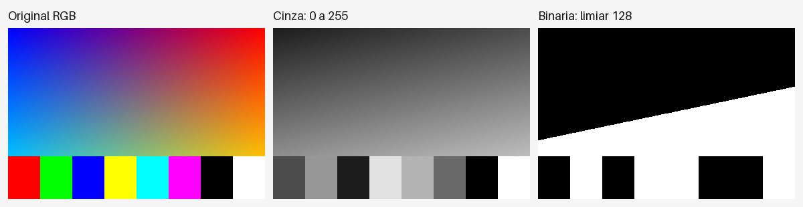

# Redução de dimensionalidade em imagens — Python

Desafio DIO: converter uma imagem colorida para níveis de cinza (0 a 255) e para uma imagem binária, contendo somente preto (0) e branco (255).

**Autor:** Giordani Martins Silva. Implementação e documentação preparadas com auxílio de IA.

[](https://colab.research.google.com/github/1giordani/trilha-python-dio/blob/main/projetos/reducao-dimensionalidade-imagens/reducao_dimensionalidade_imagens.ipynb)

## Resultado executado



O exemplo usa uma imagem própria de 384×256 pixels com gradiente RGB e faixas coloridas. O algoritmo foi executado com limiar 128 e produziu **61.440 pixels pretos e 36.864 brancos**, totalizando os 98.304 pixels da entrada. A largura e a altura foram preservadas.

| Arquivo | Conteúdo |
| --- | --- |
| [Entrada](exemplos/entrada.png) | Imagem RGB gerada pelo projeto |
| [Cinza](exemplos/resultado/cinza.png) | Um canal com intensidades de 0 a 255 |
| [Binária](exemplos/resultado/binaria.png) | Um canal com valores exclusivamente 0 e 255 |
| [Comparação](exemplos/resultado/comparacao.png) | Visualização lado a lado |
| [Relatório](exemplos/resultado/relatorio.json) | Dimensões, intervalo e contagens reais |

## Como o algoritmo funciona

Para cada pixel RGB, aplica-se a aproximação de luma:

```text
cinza = (299 × R + 587 × G + 114 × B + 500) // 1000
```

Os pesos correspondem a 0,299, 0,587 e 0,114. A soma de 500 antes da divisão inteira faz arredondamento para o inteiro mais próximo. Preto permanece 0, branco permanece 255, vermelho puro resulta em 76, verde em 150 e azul em 29. São valores de luma aproximada sobre os canais fornecidos; o projeto não faz conversão de perfil de cor nem linearização de gamma para calcular luminância física.

Em seguida, para um limiar T inteiro entre 0 e 255:

```text
se cinza >= T: saída = 255 (branco)
senão:        saída = 0   (preto)
```

O padrão é T=128. A comparação inclui igualdade: o valor 128 vira branco. T=0 produz todos os pixels brancos; T=255 deixa brancos somente os pixels de intensidade 255.

O cálculo de cinza e a decisão binária foram implementados explicitamente em Python, sem funções prontas de conversão para cinza ou de binarização. Pillow é usada para abrir, orientar, tratar transparência e salvar arquivos, além de montar a comparação.

## Executar no computador

Use Python 3.10 ou superior:

```bash
git clone https://github.com/1giordani/trilha-python-dio.git
cd trilha-python-dio/projetos/reducao-dimensionalidade-imagens
python -m pip install -r requirements.txt
python gerar_exemplo.py
python processar.py exemplos/entrada.png --saida resultados --limiar 128
```

Para usar uma foto sua:

```bash
python processar.py "minha_foto.jpg" --saida resultados-foto --limiar 150
```

A pasta de saída recebe original.png (cópia RGB normalizada), cinza.png, binaria.png, comparacao.png e relatorio.json. A entrada é preservada; o programa bloqueia a escolha de uma saída que sobrescreveria o arquivo de entrada. Reexecutar na mesma pasta substitui os resultados anteriores.

PNG e JPEG são exemplos aceitos. A orientação EXIF é respeitada e transparência é composta sobre fundo branco antes da conversão. Em arquivos animados ou com várias páginas, apenas o quadro/página atual de abertura é processado. O foco é imagem estática.

## Executar no Colab

Abra o notebook pelo botão acima e execute as células na ordem. Não é necessária GPU. Por padrão, ele gera o exemplo localmente; para enviar uma imagem própria, altere usar_imagem_propria para True. A última célula permite baixar um ZIP com as saídas.

O notebook inclui as funções do script e não depende de importar arquivos do repositório. Ele foi publicado sem saídas para permitir nova execução limpa. Não foi realizada uma sessão no Colab nesta preparação; a execução registrada foi local.

## Testes e evidências

```bash
python -m unittest test_processar -v
```

Os oito testes cobrem cores conhecidas, todos os 256 níveis de cinza, igualdade e extremos do limiar, rejeição de limiares inválidos, transparência, dimensões, preservação da entrada e bloqueio de sobrescrita. O registro de execução está em [evidencias/testes.txt](evidencias/testes.txt).

O notebook pode ser regenerado com python build_notebook.py. Sua estrutura e a execução de suas células Python também foram conferidas; veja [evidencias/validacao.json](evidencias/validacao.json).

## Conceitos e limitações

- RGB possui três canais; a imagem em cinza tem um canal.
- Binarizar reduz as intensidades possíveis a dois valores.
- As dimensões espaciais são preservadas. Esta atividade não aplica PCA nem redimensionamento de imagem.
- Cinza e binária são salvas em PNG, modo L de 8 bits. Embora a imagem binária possa ser representada teoricamente com um bit por pixel, esta implementação mantém 0 e 255 em oito bits; o tamanho final do arquivo também depende da compressão.
- Um limiar global pode apagar detalhes em regiões claras ou escuras. A escolha deve considerar a imagem e o objetivo.
- A implementação por pixel prioriza compreensão; imagens grandes demandam mais tempo e memória.

## Organização e créditos

- processar.py: funções e interface por terminal.
- gerar_exemplo.py: imagem de teste própria, sem dependência de fotos externas.
- test_processar.py: testes automatizados.
- reducao_dimensionalidade_imagens.ipynb: notebook autossuficiente para Colab/Jupyter.
- build_notebook.py: geração do notebook a partir do código.
- exemplos/: entrada e resultados reais.
- evidencias/: registros de testes e validação.
- ENTREGA-DIO.md: link e descrição para a submissão.

Enunciado e proposta educacional: Digital Innovation One, desafio “Redução de Dimensionalidade em Imagens para Redes Neurais”. A imagem Lena apresentada na aula foi uma referência visual; este projeto usa uma imagem própria. O screenshot da plataforma e dados pessoais não são adicionados ao repositório. Aulas devem ser assistidas pelo estudante.
