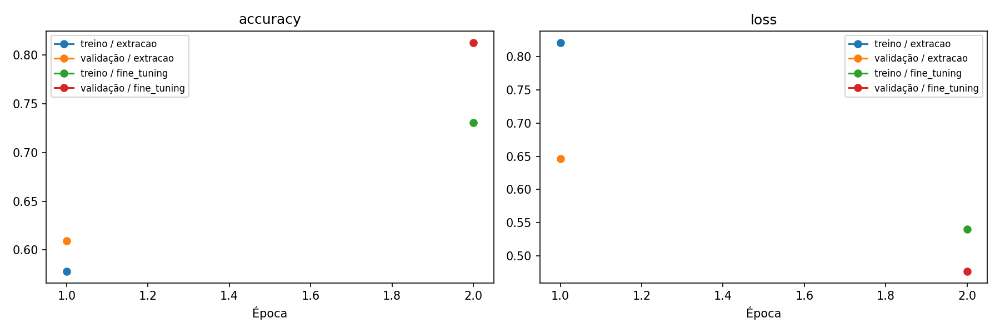
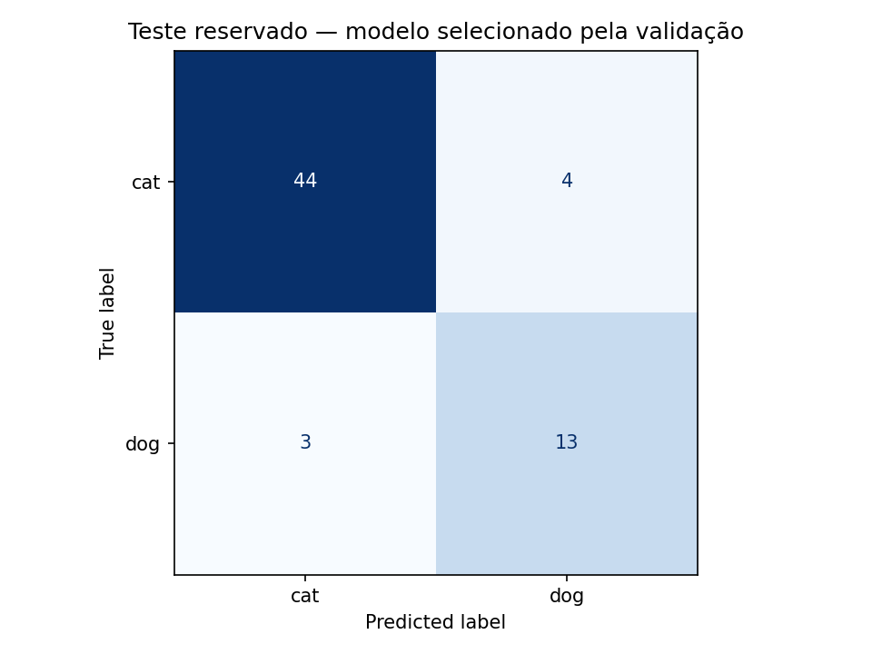

# Transfer Learning — classificação de gatos e cachorros

Projeto do desafio DIO: adaptar uma rede pré-treinada para reconhecer duas classes com Python, TensorFlow/Keras e Google Colab.

**Autor:** Giordani Martins Silva. Implementação e documentação preparadas com auxílio de IA.

[](https://colab.research.google.com/github/1giordani/trilha-python-dio/blob/main/projetos/transfer-learning-gatos-cachorros/transfer_learning_gatos_cachorros.ipynb)

## Proposta

Uma rede treinada no ImageNet já aprendeu características visuais úteis. Em vez de treinar uma rede inteira do zero, o projeto reutiliza a MobileNetV2 sem o classificador original, acrescenta uma cabeça binária e depois ajusta parte das camadas finais.

O notebook de referência do enunciado foi mantido nas fontes. Esta implementação é própria e utiliza gatos/cachorros, alternativa expressamente permitida pelo desafio; não reproduz um experimento com MNIST.

## Executar no Colab

1. Clique em **Abrir no Colab** acima.
2. Use uma sessão Python com GPU se disponível. A disponibilidade depende da sua conta e dos recursos do Colab.
3. Execute as células na ordem, do início ao fim. O notebook é autossuficiente: não precisa clonar o repositório para importar arquivos locais.
4. Aguarde o download da base e dos pesos e as duas fases de treino.
5. Confira a comparação de validação, as métricas do teste e os gráficos.
6. Na última célula, baixe o ZIP com os resultados antes de encerrar a sessão. Salve também uma cópia do notebook com as saídas se desejar documentar sua execução.

A base original tem download de aproximadamente **787 MiB** e o TFDS preparado também ocupa espaço em disco. O tempo varia conforme hardware e rede; nenhuma duração ou acurácia é garantida. Se a instalação pedir reinício, reinicie o ambiente antes dos imports e execute novamente.

## Decisões técnicas

| Etapa | Implementação e motivo |
| --- | --- |
| Dados | cats_vs_dogs:4.0.1, obtido pelo TensorFlow Datasets, com leitura do mapeamento real das classes |
| Separação | Faixas disjuntas 80% treino, 10% validação, 10% teste, antes do embaralhamento |
| Entrada | RGB 160×160 no experimento padrão; resize em lotes, sem cache integral em RAM |
| Pré-processamento | Rescaling de [0,255] para [-1,1], incorporado ao modelo |
| Aumento | Espelhamento horizontal e rotação leve, ativos apenas no treino |
| Rede | MobileNetV2 com pesos ImageNet e include_top=False |
| Cabeça | GlobalAveragePooling2D, Dropout e Dense sigmoid de uma unidade |
| Extração | Base congelada, Adam com taxa 0,001; até 5 épocas |
| Fine-tuning | Últimas 30 camadas elegíveis, BatchNormalization congelada, taxa 0,00001; até 3 épocas |
| Seleção | Melhor checkpoint por val_loss; comparação das fases apenas na validação |
| Avaliação | Teste reservado após seleção, limiar fixo de 0,5, acurácia, AUC, precisão, recall, F1 e matriz de confusão |
| Persistência | Modelo .keras com pré-processamento, classes, configuração, versões e predições |

O catálogo disponibiliza um único split chamado train; as três faixas são criadas pelo projeto. A divisão não é estratificada. As quantidades reais são obtidas do TFDS e registradas a cada execução. As imagens corrompidas tratadas pela versão do catálogo não precisam ser removidas manualmente.

As camadas de BatchNormalization são mantidas em modo de inferência durante o fine-tuning, evitando alterar suas estatísticas com poucos dados. Depois de mudar as camadas treináveis, o modelo é recompilado. O fine-tuning pode piorar a validação; nesse caso o checkpoint da extração é selecionado.

## Arquivos

- [transfer_learning_gatos_cachorros.ipynb](transfer_learning_gatos_cachorros.ipynb): notebook comentado para Colab.
- [pipeline.py](pipeline.py): dados, construção, treino em duas fases, avaliação e inferência.
- [train.py](train.py): alternativa por linha de comando.
- [requirements.txt](requirements.txt): dependências; TensorFlow 2.19.1 para reprodução local.
- [build_notebook.py](build_notebook.py): gera as células de funções a partir de pipeline.py.
- [validar_projeto.py](validar_projeto.py): valida notebook, sintaxe e correspondência com o pipeline.
- [test_model.py](test_model.py): teste de integração sem download de dados nem pesos.
- [evidencias/README.md](evidencias/README.md): escopo e resultados das verificações executadas.
- [resultados/README.md](resultados/README.md): artefatos gerados ao executar o treinamento.
- [ENTREGA-DIO.md](ENTREGA-DIO.md): link e descrição para submissão.

## Executar localmente

Com Python 3.11 ou 3.12 e ambiente virtual:

```bash
git clone https://github.com/1giordani/trilha-python-dio.git
cd trilha-python-dio/projetos/transfer-learning-gatos-cachorros
python -m venv .venv
# Linux/macOS: source .venv/bin/activate
# Windows PowerShell: .venv\Scripts\Activate.ps1
python -m pip install -r requirements.txt
python train.py
```

Para um ensaio pequeno, com parâmetros explicitamente diferentes do experimento padrão:

```bash
python train.py --head-epochs 1 --fine-epochs 1 --train-limit 256 --evaluation-limit 64 --image-size 96
```

Esse comando ainda prepara a base inteira no primeiro download. Apenas o consumo de exemplos no treino/validação/teste é limitado a 256/64/64. Serve para verificar o fluxo; métricas sobre 64 imagens não representam o desempenho no conjunto completo. Os limites e o tamanho são registrados no JSON.

A célula de instalação prepara TensorFlow 2.19.1, TFDS e dependências compatíveis, usando Python 3.11/3.12. Reinicie a sessão se solicitado após essa instalação. O experimento registra a versão efetivamente utilizada. Para reprodução local, use requirements.txt. Um conflito Protobuf/Metadata encontrado durante a preparação motivou fixar tensorflow-metadata em 1.16.1.

## Interpretação e limitações

### Ensaio local executado

Foi executada transferência real com pesos ImageNet em CPU: **256 imagens de treino, 64 de validação e 64 de teste**, resolução 96×96 e uma época por fase. A configuração padrão do notebook continua sendo o experimento completo, com resolução 160×160 e até 5+3 épocas.

| Medida | Resultado do ensaio reduzido |
| --- | --- |
| Loss de validação — extração | 0,6461 |
| Loss de validação — fine-tuning | 0,4764 |
| Modelo selecionado | Fine-tuning |
| Acurácia no teste | 89,06% (57/64) |
| AUC no teste | 0,9082 |
| F1 macro no teste | 0,8571 |
| Distribuição do teste | 48 gatos, 16 cachorros |

Nesse teste, prever sempre gato teria 75% de acerto; por isso a acurácia deve ser lida junto do relatório por classe. Foram 44 gatos e 13 cachorros corretamente classificados. O recall de cachorros foi 81,25%. O conjunto é pequeno e desbalanceado: esses números não estimam de forma robusta o desempenho na base completa.





Veja [métricas originais](evidencias/ensaio-reduzido/metricas.json), [predições](evidencias/ensaio-reduzido/predicoes.csv) e [escopo das evidências](evidencias/README.md). Esses dados vieram de execução local; não representam uma sessão no Colab nem o treinamento completo.

O teste não participa de callbacks nem da seleção do checkpoint. Não ajuste o modelo repetidamente com base nos resultados de teste. O limiar 0,5 permanece fixo; caso deseje ajustá-lo, use somente validação.

A semente facilita reprodutibilidade, mas hardware, paralelismo e versões podem alterar resultados. A divisão não remove automaticamente duplicatas ou imagens visualmente semelhantes. A proporção de classes e o domínio das imagens afetam a avaliação.

O modelo foi desenhado para duas classes e sempre decide entre elas: uma imagem de uma pessoa ou objeto ainda receberá um dos rótulos. O escore sigmoid não garante confiança calibrada. Este é um projeto educacional, sem garantia de adequação a aplicações reais.

As métricas de desempenho devem vir de execução real e acompanhadas de tamanho do teste e configuração. O notebook publicado fica sem saídas para uma nova execução limpa; consulte evidencias/ para saber o que foi efetivamente executado nesta entrega. Não foram gerados prints de aulas nem declarada a conclusão dos vídeos.

## Aprendizados documentados

- Transferência reutiliza parâmetros aprendidos; não é apenas instanciar uma arquitetura com pesos aleatórios.
- Treinar somente a cabeça reduz o número inicial de parâmetros atualizados.
- Fine-tuning exige menor taxa de aprendizado e nova compilação.
- Validação escolhe o modelo; teste estima desempenho no escopo reservado.
- Exportar classes e pré-processamento junto do modelo evita inconsistências na inferência.
- Um teste sintético confirma integração de código, mas não mede capacidade de reconhecer gatos e cachorros.

## Fontes e créditos

- Desafio educacional: Digital Innovation One.
- [Tutorial oficial TensorFlow: Transfer Learning e fine-tuning](https://www.tensorflow.org/tutorials/images/transfer_learning).
- [Catálogo TFDS Cats vs Dogs](https://www.tensorflow.org/datasets/catalog/cats_vs_dogs).
- [MobileNetV2 / Keras Applications](https://keras.io/api/applications/mobilenet/).
- [Microsoft: base original](https://www.microsoft.com/en-us/download/details.aspx?id=54765).
- [Notebook histórico indicado pela DIO](https://colab.research.google.com/github/kylemath/ml4a-guides/blob/master/notebooks/transfer-learning.ipynb).

O dataset e os pesos são baixados de suas fontes e não são redistribuídos neste repositório. Seus termos de uso continuam sendo os dos respectivos fornecedores.
