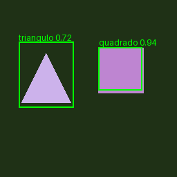

# YOLO: base rotulada e treinamento de duas classes novas

Projeto DIO de **detecção de objetos com YOLOv3-tiny e Darknet**, usando Transfer Learning a partir de pesos COCO. A rede passa de 80 para **82 classes**: mantém os índices COCO 0–79 e acrescenta marcador triangular (80) e marcador quadrado (81).

**Autor:** Giordani Martins Silva. Código e documentação preparados com auxílio de IA.

[](https://colab.research.google.com/github/1giordani/trilha-python-dio/blob/main/projetos/yolo-duas-classes/yolo_duas_classes.ipynb)

## Resultado executado



As caixas acima são **previsões do modelo treinado**, não anotações desenhadas como se fossem detecções. O exemplo pertence ao grupo de teste e usa limiar de exibição 0,25. As probabilidades são escores do detector, sem garantia de calibração.

O piloto foi executado localmente em CPU: 150 iterações, entrada 128×128, batch efetivo 4 com subdivisões 4. Foram usadas 80 imagens de treino, 20 de validação e 20 de teste. Cada imagem tem dois objetos. O orçamento foi fixado antes da avaliação, sem seleção pelo teste.

| Avaliação | AP50 triângulo | AP50 quadrado | Média AP50 das duas classes |
| --- | --- | --- | --- |
| Validação: 20 imagens | 1,0000 | 0,9905 | 0,9952 |
| Teste: 20 imagens | 1,0000 | 1,0000 | 1,0000 |

Esses números correspondem **somente à base sintética simples**, que possui viés espacial: triângulos à esquerda e quadrados à direita. Não demonstram generalização para fotos. AP50 usa IoU 0,5, envelope de precisão all-points e escores a partir de 0,01, com NMS 0,45. Não é o indicador COCO mAP@[.5:.95]. As 80 classes antigas **não foram avaliadas após o retreino**.

## Base de dados e rotulagem

Use [dataset-sintetico.zip](dataset-sintetico.zip) para obter as 120 imagens, polígonos XML, rótulos YOLO, listas e manifesto. O arquivo deve ser extraído na pasta do projeto para manter os caminhos relativos. Alternativamente, generate_dataset.py recria a base com semente 42. Não é necessário baixar o COCO inteiro.

A base é própria, sintética e **rotulada automaticamente por código**. Não houve sessão de rotulagem manual no LabelMe. Esse recorte permite testar todo o fluxo; a etapa manual com imagens reais está descrita em [docs/rotulagem.md](docs/rotulagem.md), para seguir o uso da ferramenta solicitado na aula.

O conversor aceita o XML de polígonos do **LabelMe web/MIT** apontado no enunciado. Como facilidade adicional, aceita retângulos/polígonos do **Labelme desktop**, que exporta JSON e é outro projeto. Não confunda seus formatos. Caixas normalizadas são calculadas a partir dos polígonos e das dimensões reais da imagem.

```bash
python annotations.py anotacao.xml imagem.png anotacao.txt
# Alternativa desktop:
python annotations.py anotacao.json imagem.png anotacao.txt
```

Formato YOLO: uma linha por objeto, `class_id centro_x centro_y largura altura`. As coordenadas são normalizadas entre 0 e 1. Os IDs novos são 80 e 81; não renumere para 0 e 1 nesta configuração de 82 classes.

## Como a transferência foi feita

Cada cabeça do YOLOv3-tiny possui três âncoras. Com 80 classes, são 3×(5+80)=255 filtros; com 82, são 3×(5+82)=261. Os cinco primeiros canais por âncora codificam a caixa e objectness.

**expand_weights.py copia por âncora** os canais antigos de caixa, objectness e das 80 classes. As duas saídas adicionais são inicializadas separadamente, e o contador seen é zerado para começar o novo treino. O script verifica igualdade exata dos canais copiados e valida tamanho e valores finitos do arquivo final. Simplesmente anexar seis filtros no fim não respeitaria esse agrupamento.

Essa cópia preserva os parâmetros antigos **na inicialização**. Durante o fine-tuning, os pesos compartilhados e saídas antigas podem mudar. Manter 82 nomes não garante preservar desempenho COCO. Para buscar retenção, é necessário treino com exemplos antigos completamente anotados (replay), validação independente e medição das classes antigas. Isso não foi executado neste piloto.

## Executar no Colab

Abra o notebook pelo botão acima e execute na ordem. Ele baixa este repositório, compila o Darknet original em CPU, gera a base, prepara as 82 classes, transfere pesos, treina, avalia e permite baixar um ZIP com os pesos e evidências.

O notebook é um roteiro pronto para execução, não uma sessão já executada no Colab. Seus comandos foram exercitados localmente. Ele usa CPU por compatibilidade com o Darknet antigo, sem pressupor CUDA disponível. Uma GPU selecionada no Colab não será usada automaticamente por essa compilação.

## Executar em Linux local

Requisitos: Python 3.10+, git, make e GCC. Use uma pasta de projeto sem espaços, pois os arquivos de lista do Darknet tratam caminhos como tokens. O adaptador ctypes depende da ABI do commit fixado abaixo; não o use com uma libdarknet.so de outro fork.

```bash
git clone https://github.com/1giordani/trilha-python-dio.git
cd trilha-python-dio/projetos/yolo-duas-classes
python -m pip install -r requirements.txt
git clone https://github.com/pjreddie/darknet.git darknet
git -C darknet checkout f6afaabcdf85f77e7aff2ec55c020c0e297c77f9
make -C darknet -j2 GPU=0 CUDNN=0 OPENCV=0
python prepare.py --darknet darknet --iterations 150 --size 128 --batch 4
python download_weights.py
python expand_weights.py darknet/cfg/yolov3-tiny.cfg config/yolov3-tiny-82.cfg weights/yolov3-tiny.weights weights/yolov3-tiny-82-init.weights
./darknet/darknet detector train config/dataset.data config/yolov3-tiny-82.cfg weights/yolov3-tiny-82-init.weights
python evaluate.py --darknet darknet --weights backup/yolov3-tiny-82_final.weights --split valid --output evidencias/minha-validacao
python evaluate.py --darknet darknet --weights backup/yolov3-tiny-82_final.weights --split test --output evidencias/meu-teste
```

No Windows, o Colab evita a instalação do compilador e da biblioteca Linux. O tempo depende do hardware. Os valores do piloto não são um orçamento universal para fotos reais. Aumentar resolução e batch pode aumentar bastante o custo; escolha parâmetros pelo conjunto de validação, e não pelo teste.

O script prepare.py recria a base e sobrescreve os arquivos de configuração e listas. Para usar dados próprios, prepare primeiro e depois substitua as imagens/rótulos/listas; não execute novamente o gerador sobre uma base personalizada. Alterações de taxonomia devem atualizar configuração, nomes e anotações consistentemente.

## Pesos e rastreabilidade

A fonte original indicada pela documentação, data.pjreddie.com, retornou HTTP 403 neste ambiente. Foi usada uma cópia pública no repositório mbaske/yolo-unity. download_weights.py tenta a fonte original e depois esse mirror, exigindo o mesmo hash da cópia usada no piloto:

```text
dccea06f59b781ec1234ddf8d1e94b9519a97f4245748a7d4db75d5b7080a42c
```

Esse hash permite reproduzir a cópia usada; não é apresentado como assinatura ou checksum publicado pelo autor original. A URL efetiva e o hash estão em [evidencias/execucao.json](evidencias/execucao.json). Nenhum peso grande é publicado no git; a execução gera os arquivos em backup/ e o notebook permite baixá-los. O detector final foi carregado com sucesso e teve todos os tensores conferidos como finitos.

## Evidências e testes

- [Treino completo do piloto](evidencias/treino-local.log): 150 iterações efetivamente executadas.
- [Registro do ambiente e hashes](evidencias/execucao.json).
- [Verificação do transplante](evidencias/transferencia.json).
- [Métricas de validação](evidencias/validacao/metricas.json) e [teste](evidencias/teste/metricas.json).
- [Predições do teste em JSON](evidencias/teste/predicoes.json).
- [Oito testes de código](evidencias/testes.txt).
- [Validação estática do notebook e estrutura](evidencias/estrutura.json).

```bash
python -m unittest test_project -v
python validar_estrutura.py
```

Algumas linhas de diagnóstico do Darknet mostram `-nan` para médias de uma cabeça que recebeu zero objetos naquele minibatch (`count: 0`). Isso não foi omitido do log. A perda global ao fim do piloto era finita e o arquivo de pesos finais foi inteiramente verificado como finito. As métricas externas de detecção são calculadas nas imagens reservadas, sem usar essas médias do treino como resultado de teste.

O treino nativo usa aumento de dados e implementação C; semente do gerador fixa a base, mas não garante repetição exata dos resultados de treinamento em qualquer máquina. Oito testes validam conversão, normalização, separação da base, configuração, IoU e AP em casos conhecidos; não equivalem a testar todos os possíveis dados reais.

## Organização

- annotations.py: conversão LabelMe XML/JSON para caixas YOLO.
- generate_dataset.py: base sintética e manifesto de hashes.
- prepare.py e darknet_config.py: listas, nomes e cfg de 82 classes.
- expand_weights.py: adaptação verificada dos pesos.
- download_weights.py: download com rastreabilidade e hash.
- detector.py e evaluate.py: inferência nativa e avaliação AP50 das novas classes.
- config/: configuração do piloto executado.
- referencias/: cfg e coco.names do Darknet original, preservados como referência.
- yolo_duas_classes.ipynb: roteiro Colab.
- docs/rotulagem.md: procedimento de anotação humana e limitações do exemplo.
- dataset-sintetico.zip: base completa de demonstração.
- ENTREGA-DIO.md: link e descrição para submissão.

## Fontes e escopo da entrega

- [Darknet/YOLO original](https://pjreddie.com/darknet/yolo/).
- [Código pjreddie/darknet](https://github.com/pjreddie/darknet), commit fixado no projeto; cfg/coco.names e ABI do adaptador derivados desse código.
- [LabelMe web/MIT](http://labelme.csail.mit.edu/Release3.0/).
- [Labelme desktop](https://github.com/wkentaro/labelme), suporte adicional JSON.
- [COCO](https://cocodataset.org/#home), fonte das classes e treinamento original dos pesos.
- [Mirror dos pesos usado](https://github.com/mbaske/yolo-unity/tree/master/YoloPretrained/YOLOv3-tiny).
- [Colab de referência indicado no desafio](https://colab.research.google.com/drive/1lTGZsfMaGUpBG4inDIQwIJVW476ibXk_).

Proposta educacional: Digital Innovation One. A entrega demonstra treino real de duas classes adicionais em um laboratório sintético, com código para avançar a uma base manual. **Não comprova uso manual do LabelMe, sessão no Colab, treinamento em COCO ou manutenção do desempenho das 80 classes antigas.** Assista às aulas e realize a rotulagem manual se ela for exigida na avaliação da sua turma.
